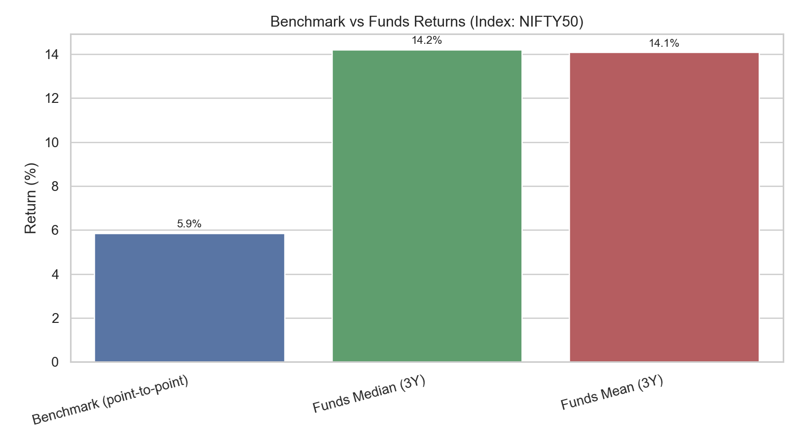
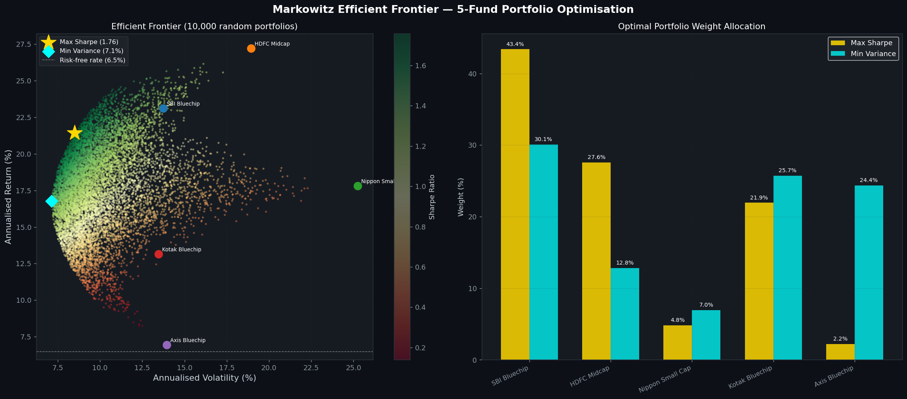
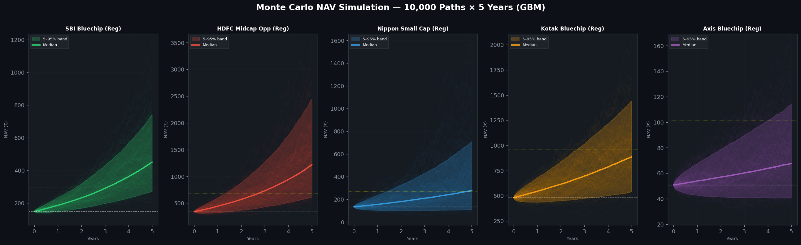
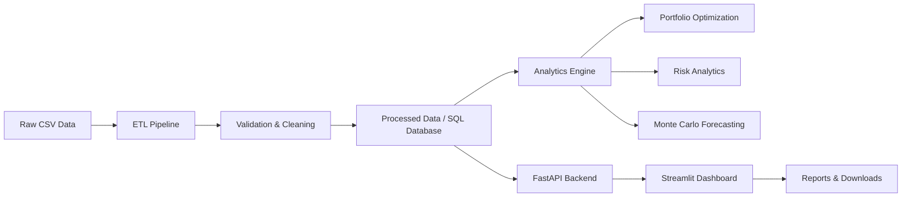

# Bluestock Mutual Fund Analytics

<div align="center">
  
  
  
  
</div>

Bluestock Mutual Fund Analytics is an end-to-end analytics platform for understanding mutual fund performance, risk exposure, portfolio construction, and market behavior through a production-style data workflow. The project combines ETL, database modeling, backend APIs, interactive dashboards, and risk analytics in one repository.

This project is designed for analysts, students, and developers who want to explore Indian mutual fund data using a real-world stack: Python, Pandas, SQL, FastAPI, Streamlit, and statistical modeling.

---

## Project Overview

The goal of this project is to convert raw mutual-fund datasets into actionable analytics. It focuses on:

- fund-level performance and risk comparisons
- benchmark and category analysis
- portfolio optimization using modern portfolio theory
- Monte Carlo forecasting for projected NAV behavior
- downloadable analytics reports and cleaned data outputs

The system follows a clean data pipeline: raw spreadsheets are cleaned, validated, loaded into a database, and then consumed by both the analytics engine and the dashboards.

---

## Screenshots

### Dashboard Overview



### Efficient Frontier and Portfolio Optimization



### Monte Carlo Forecasting



---

## Key Features

- Data ingestion and ETL for mutual fund master, NAV, holdings, inflows, and benchmark datasets
- Data quality checks and schema validation before loading to storage
- SQL-ready database design for analytics and reporting
- Risk analysis including Sharpe ratio, volatility, drawdown, and benchmark comparison
- Portfolio optimization via Markowitz frontier analysis
- Monte Carlo simulations for expected return and risk scenarios
- Streamlit-based interactive dashboard for visual exploration
- FastAPI backend endpoints for analytics services
- Downloadable CSV and report exports for analysis and presentation

---

## Technology Stack

| Layer | Tools |
| --- | --- |
| Programming Language | Python 3.11+ |
| Data Processing | Pandas, NumPy |
| Visualization | Plotly, Streamlit |
| Backend | FastAPI, SQLAlchemy |
| Data Storage | SQLite, CSV-based data marts |
| Modeling | Monte Carlo simulation, portfolio optimization |
| Testing | pytest |
| Reporting | Jupyter, PDF/CSV export workflows |
| DevOps | Docker, GitHub Actions |

---

## System Architecture



---

## Project Folder Structure

```text
bluestock-mutual-fund-analytics-main/
├── backend/                    # FastAPI app and service logic
│   └── app/
│       ├── analytics/
│       ├── api/
│       ├── core/
│       ├── database/
│       ├── etl/
│       ├── machine_learning/
│       └── services/
├── dashboard/                  # Streamlit dashboard pages and UI
│   ├── app.py
│   └── pages/
├── frontend/                   # Static landing page assets
├── data/                       # Raw and processed datasets
├── download/                   # Exported CSV outputs
├── reports/                    # Audit logs, summary reports, charts
├── scripts/                    # ETL, analytics, and utility scripts
├── sql/                        # SQL schema, queries and indexes
├── tests/                      # Automated tests
├── notebooks/                  # Exploratory notebooks
├── README.md
├── architecture.md
├── design-system.md
├── product-requirements-document.md
├── PROJECT-DOCS-INDEX.md
├── agents.md
├── Dockerfile
├── docker-compose.yml
├── requirements.txt
├── .env.example
├── .gitignore
└── .github/
```

---

## Installation & Setup

### 1. Clone the repository

```bash
git clone https://github.com/MALLAMPOLAIAHGANESH/bluestock-mutual-fund-analytics.git
cd bluestock-mutual-fund-analytics
```

### 2. Create a virtual environment

```bash
python -m venv .venv
```

On Windows:

```powershell
.venv\Scripts\activate
```

On macOS/Linux:

```bash
source .venv/bin/activate
```

### 3. Install dependencies

```bash
pip install -r requirements.txt
```

### 4. Configure environment variables

Copy the sample environment file and replace placeholder values with your local settings:

```bash
copy .env.example .env
```

### 5. Run the dashboard

```bash
streamlit run dashboard/app.py
```

### 6. Run the backend API

```bash
uvicorn backend.app.main:app --reload
```

### 7. Run tests

```bash
pytest -q
```

---

## Database & Analytics

The project is built around mutual-fund datasets such as:

- fund master information
- NAV history
- investor transactions
- portfolio holdings
- inflow and benchmark data
- category and fund-house summaries

### Core analytics included

- CAGR and absolute return measurement
- Sharpe and volatility analysis
- portfolio optimization using covariance-based frontier construction
- Monte Carlo simulation for forecast scenarios
- benchmark comparison and sector/category analysis
- risk and drawdown diagnostics

### Example analytical outputs

- portfolio frontier charts
- benchmark return comparison graphs
- Monte Carlo forecast bands
- fund scorecards and report exports

> Financial metrics are intended for educational and analytical exploration. They are not personalized investment advice.

---

## Testing & Reports

### Run the test suite

```bash
pytest tests/test_analytics.py -q
pytest tests/test_etl.py -q
pytest tests/test_recommender.py -q
```

### Generate report artifacts

```bash
python scripts/generate_pdf_report.py
```

The repository also includes generated outputs in the reports folder, including audit logs and summary analytics exports.

---

## Future Scope

Planned improvements include:

- live NAV ingestion and API integration
- deeper enterprise data pipeline automation
- extended portfolio recommendation models
- cloud deployment for public access
- richer reporting and dashboard interactivity

---

## Disclaimer

This project is built for learning, prototyping, and analytical exploration. Mutual funds and portfolio metrics can change due to market conditions, data quality, and methodology choices. Use real-world market data and appropriate validation before relying on any output for investment decisions.

---

## Contact

- GitHub: https://github.com/MALLAMPOLAIAHGANESH
- LinkedIn: https://www.linkedin.com/in/mallam-polaiah-ganesh-b33748218/

---

## Additional Documentation

- [PROJECT-DOCS-INDEX.md](PROJECT-DOCS-INDEX.md)
- [agents.md](agents.md)
- [architecture.md](architecture.md)
- [design-system.md](design-system.md)
- [product-requirements-document.md](product-requirements-document.md)

---

## License and Notes

This repository is intended for educational and portfolio-analysis purposes. Review the project files and data sources before reusing them in a production or financial advisory context.
