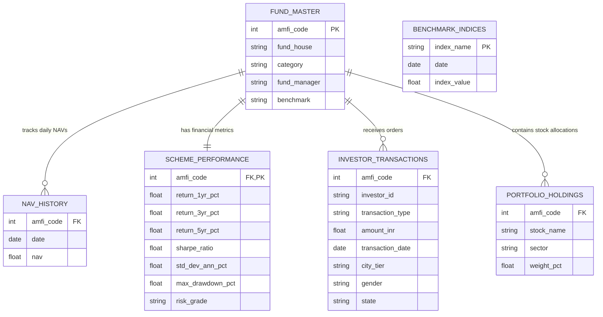

# 📈 Bluestock Mutual Fund Analytics Capstone Project

An end-to-end **Mutual Fund Analytics & Data Engineering** project built using **Python, Pandas, SQLite, Streamlit, Plotly, and Machine Learning (Monte Carlo & Markowitz)**. This project demonstrates the complete data analytics lifecycle—from raw data ingestion and cleaning to database design, statistical modeling, and an interactive business intelligence web application.

---

## 👨‍💻 Author
**Mallam Polaiah Ganesh**  
*Aspiring Data Analyst | Data Science Enthusiast | Python | SQL | Power BI | Machine Learning*  
🔗 [GitHub Profile](https://github.com/MALLAMPOLAIAHGANESH) | 🔗 [LinkedIn Profile](https://www.linkedin.com/in/mallam-polaiah-ganesh-b33748218/)

---

## 📌 Project Overview
The objective of this project is to build a production-ready data analytics pipeline for mutual fund data, providing deep insights into scheme performance, risk metrics, and investor behavior.

**The capstone includes:**
1. **Automated ETL Pipeline**: Ingestion and cleaning of 10 disparate raw datasets into a structured format.
2. **SQLite Database**: A 3NF (Third Normal Form) relational database enforcing referential integrity.
3. **Advanced Risk Analytics**: Calculation of Value at Risk (VaR), Conditional VaR (CVaR), and portfolio concentration (HHI).
4. **Statistical Modeling (Jupyter Notebooks)**:
    - **Monte Carlo Simulations**: Forecasting 5-year NAV growth trajectories using Geometric Brownian Motion.
    - **Markowitz Efficient Frontier**: Identifying optimal portfolio weightings to maximize the Sharpe Ratio.
5. **Interactive Web Dashboard**: A bespoke Streamlit application built with a custom "Midnight Slate" UI, glassmorphism CSS styling, and interactive Plotly charts.

---

## 📐 System Architecture & Database Design

### 1. Data Pipeline & Architecture
```mermaid
graph TD
    subgraph Data Sources
        RawCSV["Raw CSV Files (AMFI Data, NAV, Txns, etc.)"]
    end
    subgraph Data Pipeline (ETL)
        ETL["scripts/etl_pipeline.py"]
        Clean["Data Cleaning & Integrity Validation"]
        Audit["reports/etl_audit.json (Data Quality Log)"]
    end
    subgraph Relational Storage
        DB[("SQLite Database (bluestock_mf.db)")]
    end
    subgraph Analytics & Modeling
        MC["Monte Carlo (Geometric Brownian Motion)"]
        Markowitz["Markowitz Efficient Frontier Portfolio"]
    end
    subgraph Production UI
        Streamlit["Streamlit Dashboard (app.py)"]
    end

    RawCSV --> ETL
    ETL --> Clean
    Clean --> Audit
    Clean --> DB
    DB --> MC
    DB --> Markowitz
    DB --> Streamlit
    MC --> Streamlit
    Markowitz --> Streamlit
```

### 2. Relational Database Schema (3NF ERD)


---

## 🛠 Tech Stack
- **Data Engineering**: Python, Pandas, SQLAlchemy
- **Database**: SQLite3
- **Data Science**: Scipy, Numpy, Jupyter Notebooks
- **Frontend / BI**: Streamlit, Custom HTML/CSS, Plotly Express
- **Version Control**: Git & GitHub

---

## 🚀 How to Run the Dashboard Locally

1. **Clone the repository:**
   ```bash
   git clone https://github.com/MALLAMPOLAIAHGANESH/bluestock-mutual-fund-analytics.git
   cd bluestock-mutual-fund-analytics
   ```

2. **Install dependencies:**
   ```bash
   pip install -r requirements.txt
   ```

3. **Launch the Streamlit App:**
   ```bash
   streamlit run dashboard/app.py
   ```
   *The dashboard will automatically open in your default web browser at `http://localhost:8501`.*

---

## 📂 Repository Structure

```text
📁 bluestock-mutual-fund-analytics
│
├── 📁 dashboard/            # Streamlit frontend app & pages
│   ├── app.py               # Main entry point for the dashboard
│   ├── style.css            # Custom CSS (Midnight Slate Theme)
│   └── 📁 pages/            # Multi-page analytics (Overview, Risk, Deep Dive)
│
├── 📁 data/
│   ├── 📁 raw/              # Original unstructured CSV files
│   ├── 📁 processed/        # Cleaned CSVs ready for modeling
│   └── bluestock_mf.db      # Compiled SQLite database
│
├── 📁 notebooks/            # Jupyter Notebooks for EDA & ML Modeling
│   ├── Monte_Carlo.ipynb    # 10,000 path simulation for 5 funds
│   └── Markowitz.ipynb      # Portfolio Optimization algorithms
│
├── 📁 reports/              # Final Markdown Reports & HTML Slide Decks
│   └── 📁 images/           # Exported PNG charts and visualizations
│
├── 📁 scripts/              # Python scripts
│   └── etl_pipeline.py      # Main ETL ingestion script
│
├── requirements.txt         # Project dependencies
└── README.md                # Project documentation
```

---

## 📊 Key Features & Visualizations
- **Fund Deep Dive**: Interactive NAV charting and Sharpe ratio leaderboards.
- **Investor Cohort Analysis**: Visualizing how average SIP contribution amounts change based on the year the investor first started.
- **Rolling Sharpe Ratios**: Visualizing the risk-adjusted return consistency over 90-day rolling windows for top-performing funds.
- **Download Hub**: Raw data (`.zip`), SQLite database (`.db`), and executed Jupyter Notebooks (`.ipynb`) are all available for download directly within the dashboard UI.
