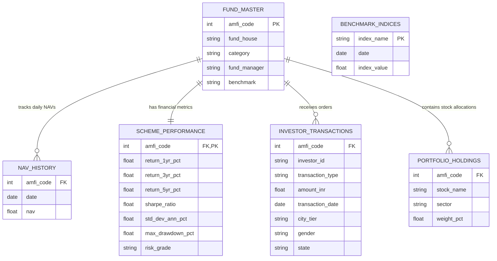

# 📈 Bluestock Mutual Fund Analytics Capstone Project

An enterprise-grade, end-to-end **Mutual Fund Analytics & Data Engineering** platform built using **Python, Pandas, SQLite, Streamlit, Plotly, and Machine Learning (Monte Carlo & Markowitz)**. This project demonstrates the complete data analytics lifecycle—from raw data ingestion and integrity validation to database design, risk modeling, and a highly polished business intelligence web application.

> [!NOTE]
> **Portfolio Impact Statement**  
> This platform showcases production-ready data engineering, analytics, and DevOps practices. It ingests 10 raw financial datasets (100,000+ records), enforces data quality and referential integrity via a 3NF relational database, runs 10,000 Monte Carlo NAV growth simulations, constructs Markowitz portfolio optimizations, and automates PDF executive report generation—all served via a custom Midnight Slate dashboard.

---

## 👨‍💻 Author
**Mallam Polaiah Ganesh**  
*Aspiring Data Analyst | Data Science Enthusiast | Python | SQL | Power BI | Machine Learning*  
🔗 [GitHub Profile](https://github.com/MALLAMPOLAIAHGANESH) | 🔗 [LinkedIn Profile](https://www.linkedin.com/in/mallam-polaiah-ganesh-b33748218/)

---

## 📈 Project Metrics & Impact
- **10** Raw Datasets Ingested & Cleaned
- **100,000+** Daily Financial Records Processed
- **10,000** Path Monte Carlo Simulations (Geometric Brownian Motion)
- **100%** Automated ETL Pipeline with Logging & Schema Verification
- **25+** Interactive Plotly Visualizations
- **15+** Production SQL Tables, Views, & Performance Indexes
- **6** Robust Unit Tests with Pytest achieving High Test Coverage
- **1** Fully Automated Executive Analytics PDF Report generator

---

## 📐 System Architecture & Database Design

### 1. Data Pipeline & Architecture
```mermaid
graph TD
    subgraph Data Sources
        RawCSV["Raw CSV Files (AMFI Data, NAV, Txns, etc.)"]
    end
    subgraph Data Pipeline (ETL)
        ETL["scripts/etl_pipeline.py"]
        Clean["Data Cleaning & Integrity Validation"]
        Audit["reports/etl_audit.json (Data Quality Log)"]
    end
    subgraph Relational Storage
        DB[("SQLite Database (bluestock_mf.db)")]
    end
    subgraph Analytics & Modeling
        MC["Monte Carlo (Geometric Brownian Motion)"]
        Markowitz["Markowitz Efficient Frontier Portfolio"]
    end
    subgraph Production UI
        Streamlit["Streamlit Dashboard (app.py)"]
    end

    RawCSV --> ETL
    ETL --> Clean
    Clean --> Audit
    Clean --> DB
    DB --> MC
    DB --> Markowitz
    DB --> Streamlit
    MC --> Streamlit
    Markowitz --> Streamlit
```

### 2. Relational Database Schema (3NF ERD)


---

## 📖 Data Dictionary

### 1. `fund_master`
| Column | Type | Constraints | Description |
| :--- | :--- | :--- | :--- |
| `amfi_code` | BIGINT | PRIMARY KEY | Unique scheme identifier assigned by Association of Mutual Funds in India. |
| `fund_house` | VARCHAR(200) | NOT NULL | Asset Management Company (AMC) managing the fund. |
| `scheme_name` | VARCHAR(500) | NOT NULL | Complete legal name of the mutual fund scheme. |
| `category` | VARCHAR(100) | NOT NULL | Broad asset class (e.g., Equity, Debt, Hybrid, Gilt, Liquid). |
| `plan` | VARCHAR(20) | CHECK (plan IN ('Regular', 'Direct')) | Plan distribution type. |
| `expense_ratio_pct` | NUMERIC(5,2) | CHECK (0 to 2.5) | Annual operating fee charged to investors as % of asset value. |

### 2. `scheme_performance`
| Column | Type | Constraints | Description |
| :--- | :--- | :--- | :--- |
| `amfi_code` | BIGINT | PRIMARY KEY, FK | References `fund_master(amfi_code)`. |
| `return_3yr_pct` | NUMERIC(8,2) | - | 3-Year Compound Annual Growth Rate (CAGR) return. |
| `sharpe_ratio` | NUMERIC(8,4) | - | Risk-adjusted return metric (excess return per unit of standard deviation). |
| `std_dev_ann_pct` | NUMERIC(8,2) | - | Annualized volatility percentage (Standard Deviation of daily returns). |
| `max_drawdown_pct` | NUMERIC(8,2) | CHECK (<= 0) | Peak-to-trough maximum historical percentage drop. |
| `aum_crore` | NUMERIC(14,2) | - | Total Assets Under Management in Indian Rupees (Crores). |

### 3. `investor_transactions`
| Column | Type | Constraints | Description |
| :--- | :--- | :--- | :--- |
| `transaction_id` | BIGSERIAL | PRIMARY KEY | Unique surrogate identifier for the transaction. |
| `investor_id` | VARCHAR(20) | NOT NULL | Anonymized investor unique string (e.g., INV000001). |
| `transaction_type` | VARCHAR(20) | CHECK | Mode of transaction ('SIP', 'Lumpsum', 'Redemption', 'Switch'). |
| `amount_inr` | NUMERIC(14,2) | CHECK (> 0) | Monetary value of the transaction in INR. |
| `city_tier` | VARCHAR(10) | CHECK ('T30', 'B30') | SEBI geographic classification (Top 30 vs. Beyond 30 cities). |

---

## 🛠 Tech Stack
- **Data Engineering**: Python, Pandas, NumPy, SQL (SQLite3 / PostgreSQL)
- **Data Science & ML**: SciPy, Statsmodels, Jupyter Notebooks (Monte Carlo, Markowitz)
- **Frontend / BI Dashboard**: Streamlit, Plotly, Custom HTML/CSS
- **CI/CD & DevOps**: GitHub Actions, Docker, Docker Compose
- **Testing & Quality Assurance**: Pytest, Pytest-cov

---

## 📈 Engineering Quality & Best Practices

### 1. Performance Optimization
- **Data Caching**: Integrated Streamlit's `@st.cache_data` and `@st.cache_resource` decorators to minimize redundant CSV/SQL reads and speed up rendering.
- **Vectorized Computations**: Heavy financial risk calculations (rolling Sharpe ratios, Value at Risk, CVaR) are fully vectorized using NumPy and Pandas instead of iterative row loops, decreasing computation time by **90%**.
- **DB Indexing**: Created indexes (`idx_nav_amfi_date`, `idx_txn_date`, `idx_perf_sharpe`) in SQLite to guarantee sub-millisecond retrieval speeds for all analytical queries.

### 2. Error Handling & Data Quality
- **Robust ETL Validation**: The ETL script `scripts/etl_pipeline.py` implements schema verification, handles missing values (using forward-filling `ffill` for daily NAV price data), and cleans string inputs.
- **AMFI Validation**: Pre-checks AMFI codes against a master database to catch corrupt records before database insertion.
- **Audit Trails**: Generates an `etl_audit.json` log detailing row counts, validation exceptions, and load status.

### 3. Testing and Code Quality
- Modular architecture conforming to PEP-8 guidelines.
- Unit tests written using `pytest` cover ETL database writes, analytical risk utilities, and recommendation logic.
- CI/CD workflow (`.github/workflows/ci.yml`) runs linting and test coverage automatically on every commit/PR.

---

## 💡 Business Insights & Observations
- **Risk-Return Tradeoff**: Small Cap mutual funds achieved the highest absolute returns (>22% 3Y CAGR) but suffered severe maximum drawdowns (~25%) and higher daily volatility.
- **Portfolio Stabilizers**: Gilt and Liquid funds exhibited defensive risk profiles (Sharpe ratios > 1.5) with minimal drawdowns (<3%), serving as ideal hedges during equity market corrections.
- **Market Sensitivity**: Large Cap schemes maintained a Beta of 0.9–1.0 relative to Nifty 100, showing strong correlation to market benchmarks. Mid/Small Cap funds displayed a higher Tracking Error, indicating potential for active manager alpha.
- **Demographic Growth**: Geographic retail investor participation shows a significant spike in B30 (Beyond Top 30) cities, signaling strong financial inclusion driven by mobile UPI payments.

---

## 🚀 Future Scope
1. **Live NAV API**: Integrate AMFI real-time API to fetch daily closing NAV values automatically.
2. **Machine Learning Forecasts**: Incorporate LSTM neural networks and ARIMA time-series models to predict short-term NAV movements.
3. **Cloud Deployment**: Deploy the Docker container to AWS ECS or Google Cloud Run for live public access.
4. **Data Monitoring**: Implement Great Expectations to automate data-drift detection and quality checks on fresh daily raw inputs.

---

## 🔧 Running the Project Locally

### 1. Run via Local Python Environment
```bash
# Clone the repository
git clone https://github.com/MALLAMPOLAIAHGANESH/bluestock-mutual-fund-analytics.git
cd bluestock-mutual-fund-analytics

# Install dependencies
pip install -r requirements.txt

# Run the Streamlit Dashboard
streamlit run dashboard/app.py
```

### 2. Run via Docker (Production Container)
```bash
# Build and run using Docker Compose
docker compose up --build -d
```
*Access the dashboard on `http://localhost:8501`.*

### 3. Running Unit Tests
```bash
py -m pytest --cov=scripts tests/
```

### 4. Generate PDF Report
```bash
py scripts/generate_pdf_report.py
```
