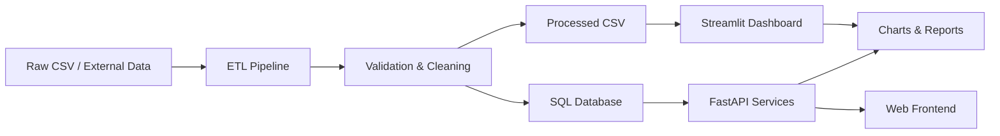

# AGENTS.md — Bluestock Mutual Fund Analytics

> **Purpose:** A practical guide for AI coding agents and human developers working on this repository.

## 1. Project Mission

Bluestock Mutual Fund Analytics is an end-to-end analytics platform for Indian mutual funds.

The system combines:

- Mutual-fund master data and historical NAV data
- ETL and data-cleaning pipelines
- SQL database design
- FastAPI backend services
- Streamlit analytics dashboard
- Static HTML/CSS/JavaScript frontend
- Risk analytics
- Portfolio optimization
- Monte Carlo simulation
- Downloadable analytical reports and datasets

The primary user outcome is **understanding fund performance and risk through simple, interactive analytics**.

---

## 2. Repository Map

```text
bluestock-mutual-fund-analytics-main/
│
├── backend/              # FastAPI + SQLAlchemy application
│   └── app/
│       ├── analytics/    # Analytics calculations
│       ├── api/          # REST API routes
│       ├── core/         # Configuration, DB, logging
│       ├── database/     # ORM models, schemas, repositories
│       ├── etl/          # ETL pipeline
│       ├── machine_learning/
│       └── services/     # Business/service layer
│
├── dashboard/            # Streamlit analytics application
│   ├── app.py
│   └── pages/
│
├── frontend/             # Static web experience
│   ├── index.html
│   ├── style.css
│   ├── responsive.css
│   ├── animations.css
│   └── script.js
│
├── data/
│   ├── raw/              # Source datasets
│   └── processed/        # Cleaned/derived datasets
│
├── notebooks/             # EDA and advanced analytics
├── scripts/               # ETL, cleaning, analytics and utilities
├── sql/                   # Schema, views, indexes and analysis queries
├── reports/               # Reports, charts and audit outputs
├── tests/                 # Automated tests
├── Dockerfile
├── docker-compose.yml
└── requirements.txt
```

---

## 3. Agent Working Rules

### Rule A — Understand before changing

Before modifying code:

1. Read the relevant README/documentation.
2. Identify the owning layer.
3. Check existing tests.
4. Preserve current API contracts unless the change explicitly requires them.
5. Reuse existing services/utilities instead of creating duplicate business logic.

### Rule B — Keep responsibilities separated

```text
UI
 ↓
API
 ↓
Service / Business Logic
 ↓
Repository / ORM
 ↓
Database
```

Do not put database queries directly into frontend code.

Do not put complex business calculations directly inside API route handlers.

### Rule C — Data is a first-class dependency

When changing analytics:

- inspect the source columns;
- verify date types;
- check missing values;
- check duplicate keys;
- validate units such as `%`, `₹ crore`, NAV and returns;
- update tests and report documentation.

### Rule D — Never silently change financial meaning

For example:

- `alpha` is not the same as absolute return.
- `beta` measures market sensitivity.
- `Sharpe` is risk-adjusted performance.
- `max_drawdown_pct` represents peak-to-trough loss.
- VaR is a loss threshold, not a guaranteed maximum loss.

User-facing explanations must make these distinctions clear.

---

## 4. API Contract

The main FastAPI API is versioned under the configured API prefix.

Important endpoint groups:

| Area | Endpoint | Purpose |
|---|---|---|
| Health | `/health` | Service health |
| Dashboard | `/dashboard` | High-level KPIs |
| Funds | `/funds` | Search/list schemes |
| Fund detail | `/fund/{amfi_code}` | Scheme details |
| NAV | `/fund/{amfi_code}/nav` | Historical NAV |
| Risk | `/risk` | Risk metrics |
| Optimization | `/portfolio/optimize` | Markowitz optimization |
| Recommendation | `/portfolio/recommend` | Risk-profile recommendations |
| Simulation | `/monte-carlo/{amfi_code}` | Monte Carlo forecast |
| Downloads | `/downloads/{file_key}` | Report/data download |

When adding an endpoint:

1. Add route.
2. Add request/response schema.
3. Put business logic in a service.
4. Use repository/ORM access for persistence.
5. Add tests.
6. Document the endpoint.

---

## 5. Data Flow



---

## 6. Analytics Development Rules

Every analytical feature should answer:

1. What business question does it solve?
2. What data does it consume?
3. What formula/algorithm is used?
4. What assumptions are made?
5. How is the result validated?
6. How is the result explained to a non-technical user?

Examples:

```text
Performance → CAGR / absolute return / benchmark comparison
Risk        → volatility / Sharpe / Sortino / VaR / drawdown
Portfolio   → covariance / expected return / optimization
Forecast    → Monte Carlo simulation
Discovery   → filtering / ranking / recommendation
```

---

## 7. UI Development Rules

The existing visual direction is a premium financial analytics interface.

Use:

- dark dashboard surfaces;
- high information density without clutter;
- clear KPI cards;
- interactive charts;
- consistent spacing;
- responsive layouts;
- accessible contrast;
- meaningful empty/error/loading states.

Avoid:

- decorative charts without a business purpose;
- unexplained financial jargon;
- inconsistent button styles;
- hard-coded analytics that should come from the API/data layer.

---

## 8. Testing

Run the appropriate tests after changes.

```bash
pytest -q
```

For focused changes:

```bash
pytest tests/test_analytics.py -q
pytest tests/test_etl.py -q
pytest tests/test_recommender.py -q
```

Backend API tests are also available under:

```text
backend/tests/
```

---

## 9. Safe Change Checklist

Before a PR/merge:

- [ ] Feature has a clear business purpose.
- [ ] Existing architecture is respected.
- [ ] Input validation exists.
- [ ] Error handling is meaningful.
- [ ] Tests pass.
- [ ] Documentation is updated.
- [ ] No secrets are committed.
- [ ] No unnecessary dependencies are introduced.
- [ ] UI is responsive.
- [ ] Financial metrics have clear definitions.
- [ ] Data lineage remains understandable.

---

## 10. Preferred Development Sequence

```text
Requirement
   ↓
Data contract
   ↓
Domain/business logic
   ↓
Repository / persistence
   ↓
API
   ↓
UI
   ↓
Tests
   ↓
Documentation
```

This sequence keeps the application understandable and reduces accidental coupling.
