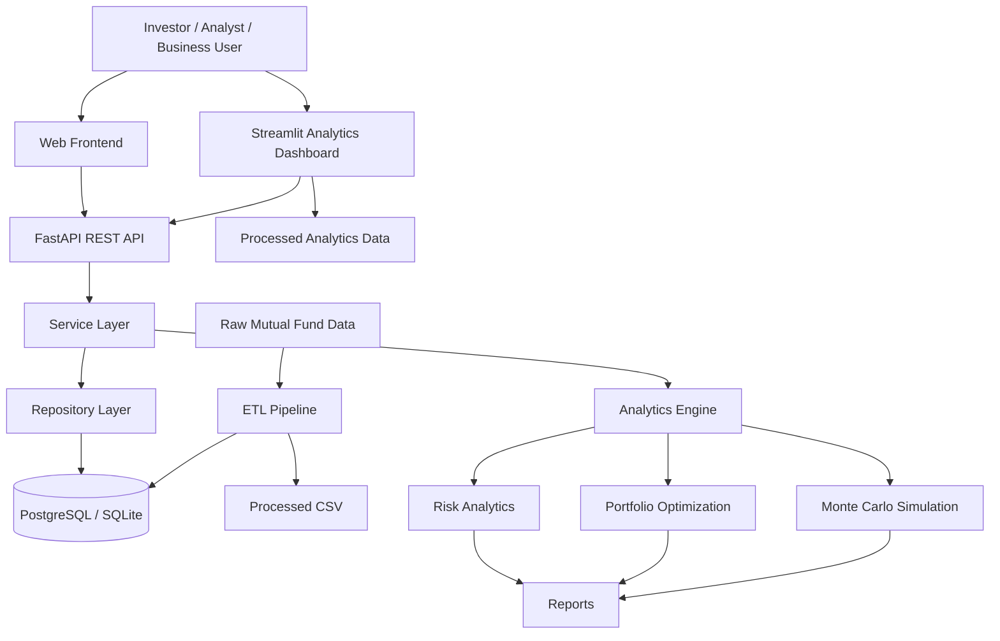
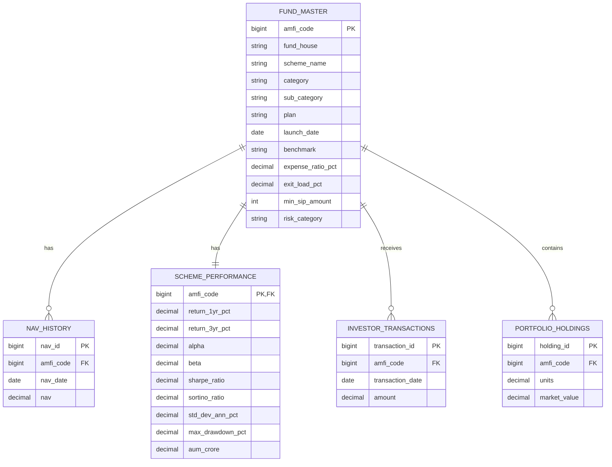
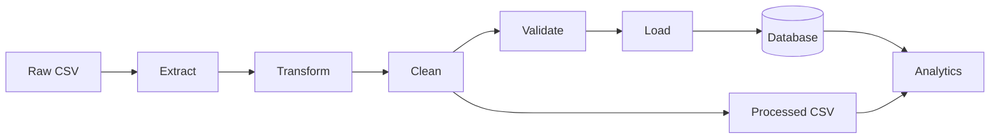
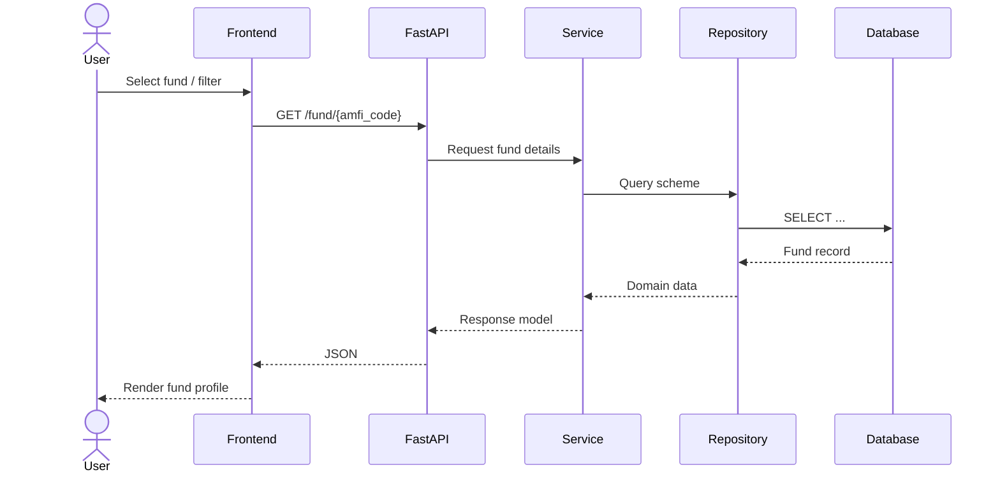
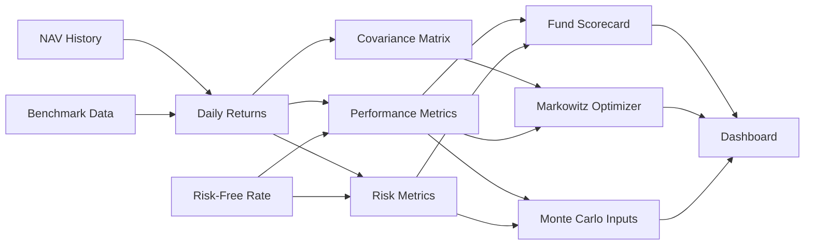
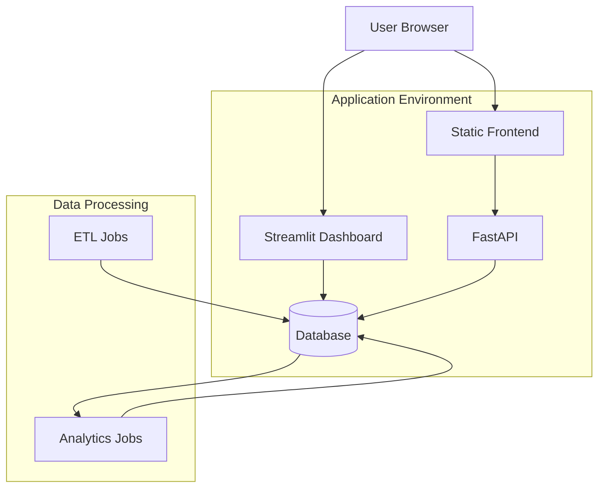

# Architecture.md — Bluestock Mutual Fund Analytics

## 1. Architecture Goal

The platform is designed as a layered analytics system rather than a single dashboard script.

The architecture separates:

- presentation,
- API,
- business logic,
- persistence,
- ETL,
- analytics,
- data,
- reporting.

---

## 2. System Context



---

## 3. High-Level Layers

### Presentation Layer

```text
frontend/
dashboard/
```

Responsibilities:

- navigation;
- filters;
- KPI presentation;
- charts;
- user interactions;
- download controls;
- responsive presentation.

The frontend should not own financial calculations.

---

### API Layer

```text
backend/app/api/
```

FastAPI endpoints expose application capabilities.

The API is responsible for:

- request validation;
- authentication/authorization when introduced;
- HTTP status handling;
- response serialization;
- routing requests to services.

---

### Service Layer

```text
backend/app/services/
```

This is the application/business layer.

Examples:

- fund discovery;
- dashboard summary;
- portfolio optimization;
- recommendations;
- simulation orchestration.

Business decisions should live here instead of being duplicated in route handlers.

---

### Repository / Database Layer

```text
backend/app/database/
backend/app/core/database.py
sql/
```

Responsibilities:

- ORM models;
- repositories;
- persistence;
- schema constraints;
- database queries;
- indexes.

---

### Analytics Layer

```text
backend/app/analytics/
backend/app/machine_learning/
scripts/
notebooks/
```

Responsibilities:

- return calculations;
- risk metrics;
- portfolio analytics;
- simulations;
- predictive/ML experiments.

---

## 4. Data Architecture

The database follows a normalized design centered on `fund_master`.



---

## 5. ETL Architecture



### ETL responsibilities

**Extract**

Read source datasets.

**Transform**

- standardize column names;
- convert dates;
- normalize categories;
- prepare numeric fields.

**Clean**

- handle missing values;
- remove duplicates;
- resolve invalid records;
- prepare NAV calendars.

**Validate**

- referential integrity;
- uniqueness;
- numeric constraints;
- required fields.

**Load**

Insert validated data into database tables.

---

## 6. Request Lifecycle



---

## 7. Analytics Pipeline



---

## 8. Deployment Architecture



The repository already contains Docker support, CI workflow files, a FastAPI backend and a Streamlit dashboard. Production deployment should keep secrets/configuration outside source control and restrict permissive CORS settings.

---

## 9. Architectural Principles

### Single source of truth

Fund identifiers and core fund metadata should originate from `fund_master`.

### Thin controllers

API routes should orchestrate, not contain large analytical algorithms.

### Reusable analytics

Risk/performance calculations should be reusable by:

- API;
- dashboard;
- reports;
- notebooks;
- scheduled jobs.

### Explainability

Every important metric should have a human-readable definition in the UI.

### Observability

Logging should capture:

- startup;
- ETL execution;
- failures;
- validation errors;
- important service events.

---

## 10. Future Scalability

A future production version can evolve toward:

```text
Object Storage
     ↓
ETL / Data Jobs
     ↓
PostgreSQL
     ↓
Caching Layer
     ↓
FastAPI
     ↓
Web App
```

Potential additions:

- authentication;
- user portfolios;
- saved watchlists;
- asynchronous jobs;
- Redis caching;
- background ETL scheduling;
- cloud object storage;
- monitoring/metrics;
- audit trails.
