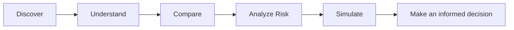

# Design System.md — Bluestock Mutual Fund Analytics

## 1. Design Direction

**Product personality:** trustworthy, analytical, modern, premium.

The interface should feel like a professional financial intelligence terminal without becoming intimidating to first-time investors.

### Design principles

1. **Clarity before decoration**
2. **Data before marketing**
3. **Consistency before customization**
4. **Progressive disclosure**
5. **Explain financial metrics in plain language**
6. **Every visualization must answer a question**

---

## 2. User Experience Model



The product should never imply that analytics constitute guaranteed investment advice.

---

## 3. Global Layout

```text
┌───────────────────────────────────────────────────────────────┐
│ BRAND      Search / Fund Search                 Alerts Profile│
├───────────────┬───────────────────────────────────────────────┤
│               │                                               │
│ Overview      │  Page title + description                     │
│ Funds         │                                               │
│ Performance   │  KPI cards                                    │
│ Risk          │                                               │
│ Portfolio     │  Charts / tables / insights                   │
│ Simulation    │                                               │
│ Investors     │                                               │
│ Reports       │                                               │
│ Data          │                                               │
│               │                                               │
│ Settings      │                                               │
└───────────────┴───────────────────────────────────────────────┘
```

---

## 4. Color Tokens

The current UI already uses a dark financial-dashboard direction.

Recommended semantic tokens:

| Token | Meaning | Suggested value |
|---|---|---|
| `--bg` | App background | `#070B14` |
| `--surface` | Main card surface | `#0F172A` |
| `--surface-2` | Secondary surface | `#111827` |
| `--border` | Borders/dividers | `#1E293B` |
| `--text` | Primary text | `#F8FAFC` |
| `--text-muted` | Secondary text | `#94A3B8` |
| `--primary` | Main action/data accent | `#3B82F6` |
| `--success` | Positive result | `#22C55E` |
| `--warning` | Attention | `#F4B400` |
| `--danger` | Loss/error | `#EF4444` |
| `--purple` | Secondary analytics | `#8B5CF6` |

> These are semantic design tokens. Components should reference tokens rather than hard-code values repeatedly.

---

## 5. Typography

Recommended hierarchy:

```text
Page title       28–36px / bold
Section title    18–22px / semibold
Card metric      24–32px / bold
Card label       12–14px / medium
Body             14–16px / regular
Caption          11–13px / regular
```

Use one primary sans-serif family throughout the application.

Typography should communicate hierarchy, not decoration.

---

## 6. Spacing

Use an 8-point spacing rhythm.

```text
4px   micro spacing
8px   compact spacing
12px  component spacing
16px  standard spacing
24px  section spacing
32px  major spacing
48px  page-level spacing
```

Avoid arbitrary one-off spacing values.

---

## 7. Core Components

### KPI Card

```text
┌───────────────────────────────┐
│ TOTAL AUM                     │
│ ₹ 12,450 Cr                   │
│ ↑ 8.4% vs previous period     │
└───────────────────────────────┘
```

Rules:

- label first;
- primary metric second;
- context/change third;
- optional tooltip for definition.

---

### Fund Card

```text
┌─────────────────────────────────────┐
│ Fund Name                 ● Very High│
│ Large Cap · Direct · Growth         │
│                                     │
│ 3Y CAGR      Sharpe       Expense   │
│ 15.8%        1.21         0.58%     │
│                                     │
│ [View Analysis]                     │
└─────────────────────────────────────┘
```

---

### Risk Badge

| Risk | Visual meaning |
|---|---|
| Low | Defensive |
| Moderate | Balanced |
| High | Growth-oriented |
| Very High | Aggressive |

Never rely on color alone; include text labels.

---

### Chart Card

```text
┌──────────────────────────────────────┐
│ Benchmark vs Fund                    │
│ Short explanation of what is shown   │
│                                      │
│       ╭───────╮                      │
│  ╭────╯       ╰───╮                  │
│──┴─────────────────┴──────────────   │
│ Legend       Date range       Filter  │
└──────────────────────────────────────┘
```

Every chart should provide:

- title;
- one-line explanation;
- legend where needed;
- tooltip;
- appropriate units;
- source/as-of date when relevant.

---

## 8. Chart Standards

### Performance

Use line charts for time-series performance.

### Fund comparison

Use grouped bars or normalized line charts.

### Risk-return

Use scatter plots:

```text
Return ↑
       │             ● Fund C
       │       ● Fund B
       │
       │  ● Fund A
       └────────────────────→ Risk
```

### Portfolio allocation

Use a donut/pie only when the number of categories is small.

For many holdings, use a horizontal bar chart.

### Drawdown

Use an area chart below zero.

### Monte Carlo

Use percentile bands rather than showing every simulation path.

---

## 9. Interaction Patterns

### Filters

Filters should be:

- visible;
- reversible;
- grouped logically;
- clearly reflected in results.

Example:

```text
Category [All ▼]
Risk     [Moderate ▼]
Plan     [Direct ▼]
Return   [3Y ▼]
```

### Search

Search should support:

- scheme name;
- fund house;
- AMFI code.

Show useful empty states:

```text
No funds found

Try:
• another fund name
• a different category
• clearing filters
```

---

## 10. Financial Data Presentation

Always show units.

Good:

```text
₹ 4,850 Cr
15.8%
1.21
₹ 128.45 NAV
```

Avoid:

```text
4850
15.8
1.21
128.45
```

Dates should be explicit when a metric has an as-of date.

---

## 11. Accessibility

Target:

- keyboard navigation;
- visible focus states;
- readable contrast;
- semantic buttons/links;
- chart alternatives where practical;
- no color-only meaning;
- responsive touch targets.

Minimum interactive target recommendation:

```text
~40–44px height
```

---

## 12. Responsive Behavior

```text
Desktop
┌────────────┬────────────────────────┐
│ Sidebar    │ Multi-column dashboard │
└────────────┴────────────────────────┘

Tablet
┌────────────┬────────────────────────┐
│ Compact    │ 2-column dashboard     │
│ Sidebar    │                        │
└────────────┴────────────────────────┘

Mobile
┌──────────────────────────────────────┐
│ Header                               │
├──────────────────────────────────────┤
│ Single-column cards                  │
│ Single-column charts                 │
│ Bottom/overlay navigation            │
└──────────────────────────────────────┘
```

Never make desktop tables simply overflow without a mobile strategy.

---

## 13. States

Every major component should support:

### Loading

Use skeletons or lightweight loading indicators.

### Empty

Explain what is missing and what the user can do.

### Error

Explain the problem without exposing stack traces.

### Success

Confirm the completed action.

Example:

```text
✓ Portfolio optimized successfully
Maximum Sharpe portfolio calculated for 5 selected funds.
```

---

## 14. Motion

Motion should communicate state, not distract.

Use:

- short hover transitions;
- chart entrance animation;
- subtle page transitions;
- modal transitions.

Avoid:

- constant pulsing;
- excessive parallax;
- long transitions;
- animation on every element.

---

## 15. Voice & Microcopy

Use plain language.

Instead of:

> Historical annualized standard deviation

Prefer:

> Volatility — how much the fund's returns have moved historically.

Instead of:

> Monte Carlo GBM simulation

Prefer:

> Possible future value ranges based on historical return and volatility assumptions.

Technical details can remain available in an information tooltip.

---

## 16. Design QA Checklist

- [ ] Same spacing rhythm
- [ ] Same button hierarchy
- [ ] Same card treatment
- [ ] Same chart typography
- [ ] Clear financial units
- [ ] Responsive layout
- [ ] Accessible contrast
- [ ] Loading state
- [ ] Empty state
- [ ] Error state
- [ ] Metric definitions
- [ ] No misleading investment claims
