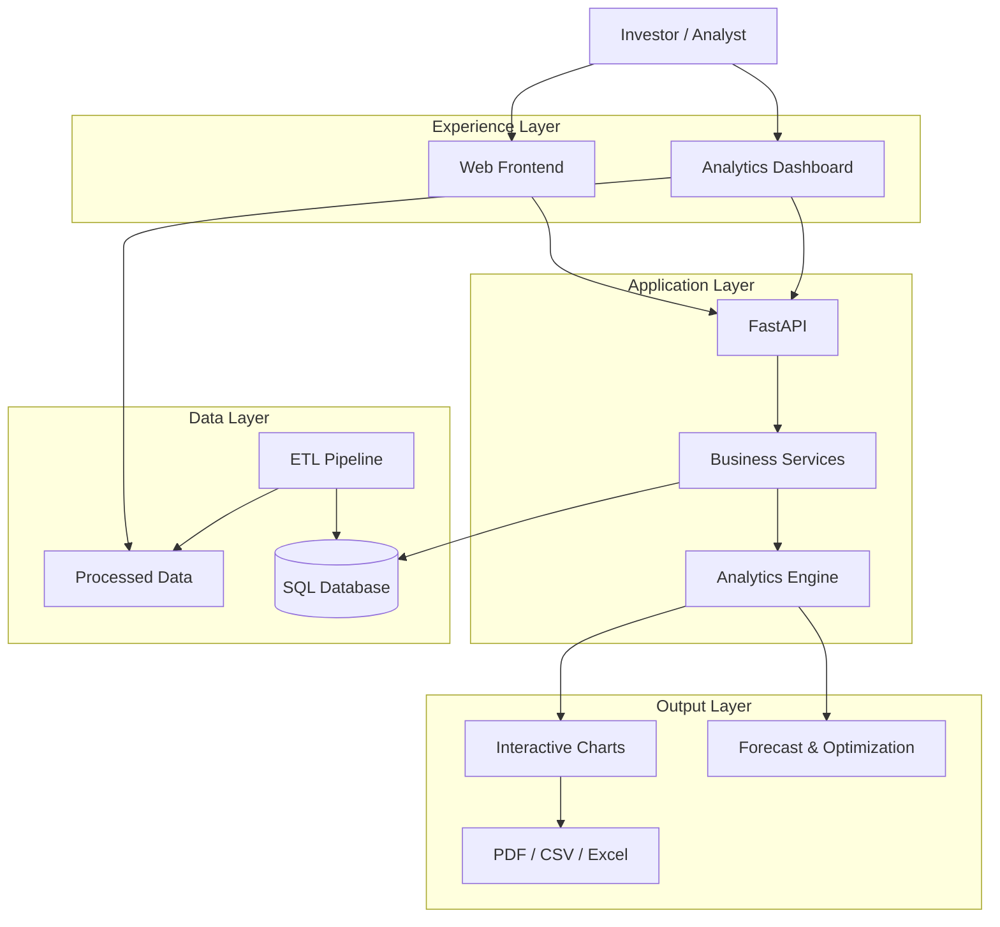
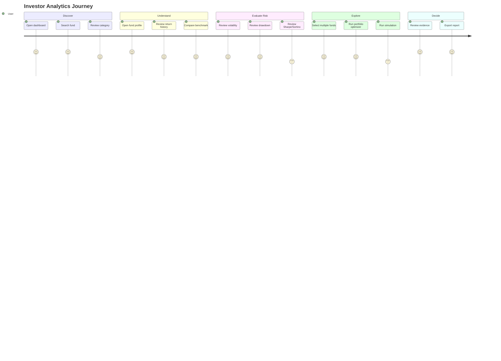
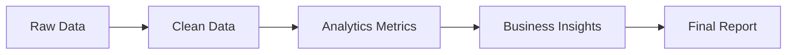

# Product Requirements Document — Bluestock Mutual Fund Analytics

## 1. Product Summary

### Product name

**Bluestock Mutual Fund Analytics**

### Product type

Interactive mutual-fund analytics and portfolio intelligence platform.

### Primary users

1. **Investors** — want to understand funds before making decisions.
2. **Analysts** — need performance, risk and portfolio analytics.
3. **Business stakeholders** — need market and investor insights.
4. **Developers/data teams** — need a reliable analytics foundation.

---

## 2. Problem Statement

Mutual-fund information is often fragmented across datasets, websites and spreadsheets.

Users need a single place to:

- discover funds;
- compare performance;
- understand risk;
- inspect historical NAV;
- evaluate benchmark-relative performance;
- understand investor activity;
- test portfolio combinations;
- explore possible future value ranges;
- download analytical outputs.

The product turns raw mutual-fund data into an understandable analytics experience.

---

## 3. Product Goal

> **Make mutual-fund data easier to understand by combining clean data, financial analytics and interactive visualizations in one platform.**

Success means a user can move from:

```text
"I don't understand this fund"
        ↓
"What does it invest in?"
        ↓
"How has it performed?"
        ↓
"How risky has it been?"
        ↓
"How does it compare?"
        ↓
"What happens if I combine funds?"
```

---

## 4. Product Scope

### In scope

- Fund discovery
- Fund details
- NAV history
- Performance analytics
- Benchmark comparison
- Risk analytics
- Investor/SIP analytics
- Portfolio recommendations
- Markowitz optimization
- Monte Carlo simulation
- Data/report downloads
- Interactive dashboard
- REST API
- ETL/data-quality workflows

### Out of scope for the current version

- Real-money trading
- Brokerage execution
- Guaranteed investment advice
- Personalized regulated financial advice
- Live order placement
- Custody/account management

---

## 5. Product Architecture



---

## 6. Main User Journey



---

## 7. Functional Requirements

### FR-001 — Dashboard

The system shall display high-level market/fund KPIs.

Examples:

- total AUM;
- number of funds;
- fund houses;
- average return;
- average expense ratio;
- top-performing scheme;
- lowest-volatility scheme;
- portfolio health score.

---

### FR-002 — Fund Search

Users shall be able to search by:

- fund name;
- fund house;
- AMFI code.

Users shall be able to filter by:

- category;
- sub-category;
- plan;
- risk category.

---

### FR-003 — Fund Profile

A fund profile shall show:

- fund name;
- fund house;
- category;
- plan;
- benchmark;
- expense ratio;
- minimum SIP;
- risk grade;
- performance;
- risk metrics;
- NAV history.

---

### FR-004 — Performance Analytics

The system shall provide:

- 1Y return;
- 3Y CAGR;
- 5Y CAGR where available;
- benchmark comparison;
- alpha;
- beta;
- performance charts.

---

### FR-005 — Risk Analytics

The system shall provide:

- volatility;
- Sharpe ratio;
- Sortino ratio;
- maximum drawdown;
- historical VaR;
- CVaR where available.

Each metric should have a plain-language explanation.

---

### FR-006 — Portfolio Optimization

Users shall select multiple funds and provide a risk-free rate.

The system shall calculate an optimized portfolio using Markowitz-style optimization.

Output:

- selected funds;
- suggested weights;
- expected return;
- portfolio risk;
- Sharpe ratio;
- efficient frontier where available.

---

### FR-007 — Recommendations

The system shall support risk-tier recommendations:

```text
Low
Moderate
High
Very High
```

Recommendations must be presented as analytics, not guaranteed investment advice.

---

### FR-008 — Monte Carlo Simulation

Users shall select a fund and simulation horizon.

The system shall display:

- simulated value distribution;
- median/expected path;
- percentile bands;
- upside/downside scenarios.

The UI must clearly state that simulation outcomes are model-based scenarios rather than predictions or guarantees.

---

### FR-009 — Investor Analytics

The system shall support analysis of:

- transaction activity;
- SIP inflows;
- investor cohorts;
- category-level flows;
- geographic/segment patterns when present in the data.

---

### FR-010 — Downloads

Users shall be able to download supported:

- CSV datasets;
- Excel datasets;
- PDF reports;
- SQL/schema artifacts;
- notebooks where applicable.

---

## 8. Non-Functional Requirements

### Performance

Target:

- fast initial dashboard load;
- cached analytical datasets;
- paginated fund search;
- asynchronous processing for expensive simulations where needed.

### Reliability

- meaningful API errors;
- validation;
- logging;
- automated tests;
- reproducible ETL.

### Security

- secrets in environment configuration;
- restricted CORS in production;
- input validation;
- least-privilege database access;
- no credentials in source code.

### Accessibility

- keyboard support;
- semantic controls;
- readable contrast;
- clear labels;
- non-color-only risk states.

### Maintainability

- layered architecture;
- documented data contracts;
- reusable analytics;
- testable services.

---

## 9. Core Data Requirements

Primary entities include:

```text
Fund
 ├── NAV History
 ├── Performance
 ├── Investor Transactions
 └── Portfolio Holdings

Market / Category Aggregates
 ├── AUM
 ├── SIP Inflows
 ├── Category Inflows
 └── Folio Counts

Benchmark
 └── Index History
```

---

## 10. Acceptance Criteria

### Dashboard

- [ ] KPIs render from data.
- [ ] Values have correct units.
- [ ] Charts respond to filters.
- [ ] Errors are handled gracefully.

### Fund Search

- [ ] Name search works.
- [ ] Category filter works.
- [ ] Search results are paginated.
- [ ] No-result state is understandable.

### Fund Detail

- [ ] Fund metadata loads.
- [ ] NAV chart loads.
- [ ] Performance metrics load.
- [ ] Risk metrics load.

### Portfolio

- [ ] User can select multiple funds.
- [ ] Invalid input is rejected.
- [ ] Optimization returns weights.
- [ ] Weights are explainable.
- [ ] Optimization errors are handled.

### Simulation

- [ ] Horizon is validated.
- [ ] Simulation count is validated.
- [ ] Results are visualized.
- [ ] Scenario limitations are shown.

### Reports

- [ ] Download links return correct files.
- [ ] Generated reports match displayed analytics.
- [ ] Exported data has clear column names.

---

## 11. Analytics Definitions

| Metric | User-friendly meaning |
|---|---|
| NAV | Value of one fund unit |
| CAGR | Average annual compounded growth |
| Alpha | Return above/below benchmark after considering the model |
| Beta | Sensitivity to market movements |
| Volatility | How much returns have historically moved |
| Sharpe | Return earned for each unit of total risk |
| Sortino | Return earned relative to downside risk |
| Max Drawdown | Largest peak-to-trough decline |
| VaR | Estimated loss threshold at a selected confidence level |
| CVaR | Average loss beyond the VaR threshold |
| AUM | Total assets managed by the fund |
| SIP | Regular investment contribution |

---

## 12. Reporting Requirements

The reporting system should support the following layers:



### Report structure

1. Executive summary
2. Data quality
3. Market overview
4. Fund performance
5. Risk analytics
6. Investor analytics
7. Portfolio analytics
8. Monte Carlo scenarios
9. Recommendations/observations
10. Methodology
11. Limitations
12. Appendix

---

## 13. Product Navigation

Recommended information architecture:

```text
Overview
│
├── Fund Explorer
│   └── Fund Detail
│
├── Performance
│
├── Risk Analytics
│
├── Investor Analysis
│
├── Portfolio Lab
│   ├── Recommendations
│   ├── Optimizer
│   └── Monte Carlo
│
├── Reports
│
└── Data & Downloads
```

---

## 14. MVP Priorities

### P0 — Must have

- Dashboard
- Fund search
- Fund detail
- Performance
- Risk
- NAV history
- API
- Data downloads

### P1 — High value

- Portfolio recommendations
- Markowitz optimizer
- Monte Carlo
- Investor analytics
- Advanced report generation

### P2 — Future

- Authentication
- Saved portfolios
- Watchlists
- Notifications
- Cloud deployment
- Scheduled data refresh
- Personalized analytics

---

## 15. Product Success Metrics

Technical:

- API error rate;
- dashboard load time;
- test coverage;
- ETL success rate;
- data-quality failure rate.

Product:

- fund searches;
- fund-detail views;
- comparison usage;
- report exports;
- optimizer usage;
- simulation usage.

Quality:

- metric consistency between API/dashboard/reports;
- freshness of data;
- completeness of fund records.

---

## 16. Risk and Compliance Considerations

The product is an analytics and educational decision-support system.

User-facing language should avoid:

```text
"Guaranteed return"
"Risk-free investment"
"This fund will outperform"
"Buy this fund"
```

Prefer:

```text
"Historical performance"
"Model-based scenario"
"Risk-adjusted metric"
"Based on available historical data"
"Use this analysis as one input into your decision"
```

---

## 17. Definition of Done

A feature is complete when:

```text
Requirement
   ↓
Implemented
   ↓
Validated
   ↓
Tested
   ↓
Documented
   ↓
Displayed clearly
   ↓
Export/report checked
```

A technically working feature is **not** complete if the user cannot understand what the result means.
